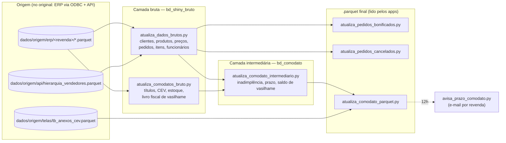

# Pipeline de dados em Python — distribuidora de bebidas

Pipeline noturna que extrai os dados do ERP de cada revenda de uma distribuidora de bebidas, monta uma camada bruta e uma camada intermediária e grava os arquivos `.parquet` que os painéis em **Shiny for Python** leem. Um segundo fluxo, ao meio-dia, avisa por e-mail os comodatos (equipamentos emprestados a clientes) cujo prazo de documentação está acabando.

Este repositório é um **recorte de demonstração** da pipeline real, preparado para o portfólio (seção *Engenharia de Dados — Python*). Ele roda inteiro numa máquina comum, sem servidor, sem ERP e sem banco de dados.

> **Aviso: todos os dados são fictícios.** Revendas, CNPJs, clientes, CPFs, telefones, endereços, e-mails e valores foram gerados por `dados/gerar_dados_ficticios.py`. Os CNPJs/CPFs têm formato de propósito falso (sequências de 1, 2, 3, zeros e noves). Nenhum dado de empresa ou pessoa real está aqui.

Desenvolvida pelo autor com ajuda do **Claude** (assistente de IA da Anthropic), tanto no porte original de R para Python quanto na preparação deste recorte.

---

## O que ela alimenta

Os `.parquet` gerados aqui são o "cache" que os apps Shiny for Python leem: as telas nunca consultam o banco ao vivo, só abrem o arquivo pronto. Apps do portfólio: **https://github.com/biuspoly/Shiny-Python-Portifolio**

| Saída | App / tela |
|---|---|
| `Acompanhamento Comercial/data/bd_dlp/tb_historico_bonif.parquet` | Comercial → Pedidos Bonificados |
| `Acompanhamento Comercial/data/bd_dlp/tb_historico_dlp*.parquet` (4 arquivos) | Comercial → Pedidos Cancelados (limite CPF, SKU mínimo, combo, fora de rota) |
| `Acompanhamento Logistico/data/bd_comodato/*.parquet` (6 tabelas + partições por revenda) | Logístico → Comodatos (abas Geral, Vasilhames, Solicitação) |
| `.../_atualizacoes.json` | Card "Atualizado em" do cabeçalho de cada tela |

---

## Camadas e ordem



Ordem do flow da madrugada (`orquestracao/flows.py::ORDEM_PIPELINE_COMPLETO`), **um script de cada vez**:

1. `dados_brutos/atualiza_dados_brutos.py` — sem dependência
2. `dados_brutos/atualiza_comodatos_bruto.py` — sem dependência
3. `Acompanhamento Comercial/atualiza_pedidos_bonificados.py` — depende de 1
4. `Acompanhamento Comercial/atualiza_pedidos_cancelados.py` — depende de 1
5. `Acompanhamento Logistico/atualiza_comodato_intermediario.py` — depende de 1 e 2
6. `Acompanhamento Logistico/atualiza_comodato_parquet.py` — depende de 5

Se um passo falha (depois de uma nova tentativa automática), os passos que **dependem dele** são pulados e registrados como "pulado"; os independentes seguem. Cada execução vira uma linha em `orquestracao/parquet/execucoes.parquet` (duração, status, fim da saída), usado também para estimar o tempo das próximas.

### Decisões que vieram de problema real

- **Sequencial entre scripts.** A orquestração já foi paralela (Prefect com `.submit()`): vários scripts abrindo uma conexão ODBC por revenda ao mesmo tempo travaram a máquina. Hoje o único paralelismo é *dentro* de cada script da camada bruta (uma thread por revenda, com prazo total de espera).
- **Troca por revenda, não recriação da tabela** (`dados_brutos/scripts/gravacao_bruta.py`). Antes, cada tabela era recriada só com as revendas que responderam a tempo; uma revenda fora do ar sumia da base. Agora só as linhas de quem respondeu são trocadas. Dá para ver isso acontecendo: renomeie `dados/origem/erp/aurora/` e rode a camada bruta; a Aurora continua na base com os dados anteriores.
- **Janela recente.** Pedidos, itens e livro fiscal não são reprocessados inteiros todo dia: só a janela recente mais qualquer mês que falte na base local (um buraco isolado pede só aquele mês).
- **Escrita atômica** do histórico de execuções e das tabelas: arquivo temporário + troca de nome, para uma interrupção nunca deixar arquivo pela metade.
- **`SOMENTE_PARQUET=1`**: um único ponto de gravação (`core/parquet.py`) permite regenerar só os `.parquet` finais sem tocar no banco (`gerar_parquet.bat`).

---

## Agendamento

| O quê | Quando | Como |
|---|---|---|
| Pipeline completo (`pipeline_completo_producao`) | **madrugada** | No servidor original: Agendador de Tarefas do Windows chamando `orquestracao/iniciar.bat` à 1h. Alternativa no mesmo código: `orquestracao/agendamento.py` (Prefect `serve`, cron `ORQUESTRACAO_CRON`, padrão 3h). |
| Aviso de prazo de comodato (`aviso_prazo_comodato`) | **meio-dia** | Agenda própria (`AVISO_PRAZO_CRON`, padrão `0 12 * * *`). Fica fora da madrugada de propósito: é mensagem para as pessoas, não geração de dado, e chega na frente de quem está trabalhando. |

O `agendamento.py` sobe os dois horários no mesmo processo, com o estado do Prefect num SQLite local (sem `prefect server`). Em produção roda como serviço do Windows (NSSM).

---

## Como rodar (dados fictícios)

Requisitos: Python 3.10+.

```bash
python -m venv .venv
.venv\Scripts\activate            # Linux/macOS: source .venv/bin/activate
pip install -r requirements.txt

# 1. (opcional) regerar a origem fictícia com datas relativas a hoje
#    os arquivos versionados já funcionam, mas os prazos e a "janela recente"
#    são calculados a partir da data de hoje
python dados/gerar_dados_ficticios.py

# 2. rodar a pipeline UMA vez
python orquestracao/flows.py --uma-vez                 # via Prefect (modo efêmero, sem servidor)
python orquestracao/flows.py --uma-vez --sem-prefect   # mesma ordem, Python puro

# 3. o aviso do meio-dia (grava os e-mails em saida/emails/*.eml, não envia)
python orquestracao/flows.py --uma-vez --aviso

# 4. manter os dois agendamentos ativos (madrugada + meio-dia)
cd orquestracao && python agendamento.py
```

Cada script também roda sozinho, por exemplo `python "Acompanhamento Logistico/scripts/avisa_prazo_comodato.py"` (sem `--executar` só ensaia; `--revenda Aurora`, `--reenviar`, `--esquecer`). No Windows há os atalhos `gerar_parquet.bat` (só os `.parquet` finais, com `SOMENTE_PARQUET=1`) e `avisar_prazo_comodato.bat`.

Resultado de uma execução com os dados fictícios: 6/6 passos OK em cerca de 10 s; camada bruta com 240 clientes, 1.040 pedidos e 167 itens de comodato (4 revendas); 5 tabelas finais no Comercial e 22 arquivos no Logístico (6 tabelas mais as partições por revenda das 4 maiores); aviso com 45 comodatos em faixa de aperto e 3 e-mails gerados (uma revenda está sem destinatário de propósito). Rodar o aviso de novo não repete: cada comodato é avisado uma vez por faixa.

### Estrutura

```
core/                    revendas (tabela única), "bancos" em Parquet, ponto único de gravação, credenciais
dados/
  gerar_dados_ficticios.py
  origem/                Parquet de ORIGEM fictícios (o "ERP", a "API" e o que a tela grava)
dados_brutos/scripts/    camada bruta + consultas_erp.py (as consultas ao ERP, com nomes genéricos, como referência)
Acompanhamento Comercial/scripts/     .parquet de Pedidos Bonificados e Cancelados
Acompanhamento Logistico/scripts/     camada intermediária e .parquet de Comodatos, aviso de prazo
Acompanhamento Logistico/comodatos/   regras de prazo e montagem do e-mail
config/avisos_prazo_comodato.json     destinatários (fictícios, @example.com)
orquestracao/            flows.py (Prefect), agendamento.py, iniciar.bat
```

Geradas na execução (fora do Git): `dados/bancos/` (os "bancos"), `*/data/` (os `.parquet` finais), `saida/emails/`, `orquestracao/parquet/`, `logs/`.

---

## O que mudou em relação ao original

| Original | Aqui |
|---|---|
| ERP de cada revenda via ODBC (`pyodbc`, um DSN por revenda) | `dados/origem/erp/<revenda>/<consulta>.parquet`, com as **mesmas colunas** que cada consulta devolve; as consultas estão em `dados_brutos/scripts/consultas_erp.py`, com a lógica original e tabelas/colunas do ERP renomeadas para nomes genéricos (`ERP_CLIENTES`, `ERP_PEDIDOS_0n`, `CLI_RAZAO_SOCIAL`, `PED_NUMERO`...) |
| Códigos de produto do catálogo real | códigos fictícios (vasilhames e materiais `7001xx`–`7005xx`, SKUs da regra de combo `800001`/`800002`) |
| MySQL (`bd_shiny_bruto`, `bd_comodato`, `bd_dlp`) via SQLAlchemy | uma pasta de Parquet por banco (`dados/bancos/`); as consultas SQL continuam SQL, executadas pelo **DuckDB** sobre os arquivos (`core/banco.py`), com ajustes mínimos de dialeto anotados no código |
| API de hierarquia de vendedores (HTTP + chave) | `dados/origem/api/hierarquia_vendedores.parquet` |
| Envio de e-mail por SMTP | mesma mensagem (texto + HTML), gravada em `saida/emails/<revenda>.eml` e mostrada no log |
| Credenciais lidas do `.env` em cada script | nenhuma é necessária; o ponto para ligar num cofre é `core/credenciais.py::obter_credencial(nome)` |
| 11 revendas reais | 4 revendas fictícias |
| Uma cópia de `core/` por app | um `core/` compartilhado na raiz |

## O que ficou de fora (e por quê)

O flow real da madrugada tem **mais de 80 passos**. Este recorte leva a cadeia de ponta a ponta mais representativa (bruta → intermediária → final + aviso) e deixa de fora:

- **Financeiro e Fiscal** (cerca de 40 passos: extratos, conciliação, vínculos de documentos, livros fiscais, pré-auditoria): dependem de arquivos em rede, de outros ERPs e de documentos da empresa; o padrão de orquestração é o mesmo.
- **Demais pipelines do Comercial** (Diário de Venda, Mapa Comercial, Curva ABC, Indicadores, Ranking, Markup, Trade, Carteira, SKU/FDS) e do **Logístico** (Frota, Devoluções, Romaneios, Entregas, Solicitações): seguem o mesmo molde dos que estão aqui (lê a camada bruta → calcula em Polars → grava `.parquet`). Ficaram de fora por volume, não por diferença de técnica.
- **Integrações com APIs externas** (abastecimento/frota, tabela FIPE, geolocalização, IBGE), inclusive a agenda própria das 2h de uma delas: exigem credencial e expõem dados de veículos.
- **Passos que escrevem de volta no ERP** (envio de custo, conferência e cancelamento de pré-pedidos): não fazem sentido sem o ERP.
- **Atualização sob demanda por revenda** (botão "Atualizar" das telas, via fila Celery/Redis) e o modo `--cnpj` dos scripts.
- **Monitoramento** (`logs_pipeline`: registro de cada execução para um app de monitoramento) e o espelho para o app mobile.
- Os atalhos `gerar_parquet_comodato.bat` e `gerar_parquet_compras.bat` (variações do `gerar_parquet.bat`).
- Dentro dos scripts mantidos: tabelas da camada bruta que só os pipelines excluídos usam (vendas/devoluções, motoristas, vendedores, romaneios, metas, condição de pagamento), a regra de uma revenda que divide o ERP com outra, as listas de cliente de exceção do comodato e a manutenção de índices/colunas que só existe no MySQL.
